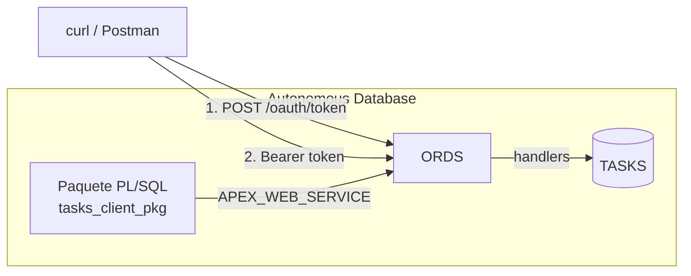

# Exponer API desde Oracle (ORDS) y consumirla desde Oracle

API REST construida con **Oracle REST Data Services (ORDS)** sobre una
**Autonomous Database Always Free**, protegida con **OAuth2** y consumida desde
la propia base de datos con **PL/SQL** (`APEX_WEB_SERVICE`).

El proyecto cubre los dos lados de una integracion REST en Oracle: exponer una
API y consumirla.

## Consideraciones

- AutoREST frente a modulos a medida (contrato propio y versionado `/v1/`).
- Handlers PL/SQL con control del codigo HTTP (`201`, `204`, `400`, `404`).
- Seguridad: roles, privilegios y cliente OAuth2 `client_credentials`.
- Consumo de una API protegida desde PL/SQL y tratamiento del JSON con `JSON_TABLE`.
- Despliegue reproducible con scripts SQL versionados.

## Arquitectura



## Requisitos

- Oracle Cloud **Autonomous Database Always Free**
  (Transaction Processing o APEX Service).
- Acceso como `ADMIN` para el paso inicial.
- SQLcl (o Database Actions / SQL Workshop) o SQLDeveloper para ejecutar los scripts.
- Postman.

## Estructura

```
.
├── sql/
│   ├── 00_admin/               # usuario, alias ORDS y workspace (como ADMIN)
│   ├── 01_schema/              # tablas y datos de ejemplo
│   ├── 02_ords/                # AutoREST, modulo v1, seguridad, undeploy
│   └── 03_consumer/            # paquete consumidor y script de prueba
├── postman/                    # coleccion y environment (sin secretos)
└── docs/                       # capturas
```

## Despliegue

1. Como **ADMIN**, ejecuta `sql/00_admin/01_create_user.sql`. Crea el usuario
   `TASKS_DEV`, habilita ORDS con el alias `api` y crea el workspace APEX `TASKS`.
2. Como **TASKS_DEV** ejecutar resto de scripts en el orden indicado en el nombre del fichero.
3. Consulta las credenciales OAuth2:
   ```sql
   SELECT name, client_id, client_secret FROM user_ords_clients;
4. Se incluye exportación del fichero postman eliminando la url y las credenciales.

> Para entrar en Database Actions con `TASKS_DEV` usa la ruta del alias:
> `https://<host>/ords/api/sql-developer`.

## Endpoints

Base URL: `https://<host>.adb.<region>.oraclecloudapps.com/ords/api`

| Metodo | Ruta | Descripcion | Respuestas |
|---|---|---|---|
| GET | `/v1/tasks/` | Lista paginada. Filtro `?status=TODO` | 200 |
| POST | `/v1/tasks/` | Crea una tarea (`title` obligatorio) | 201, 400 |
| GET | `/v1/tasks/{id}` | Detalle | 200, 404 |
| PUT | `/v1/tasks/{id}` | Actualizacion parcial | 204, 400, 404 |
| DELETE | `/v1/tasks/{id}` | Borra la tarea | 204, 404 |
| POST | `/oauth/token` | Token OAuth2 (`client_credentials`) | 200, 401 |

Campos: `title`, `description`, `status` (`TODO` / `DOING` / `DONE`) y
`due_date` (formato `YYYY-MM-DD`).

## Ejemplos

```bash
BASE="https://<host>.adb.<region>.oraclecloudapps.com/ords/api"

# Token
TOKEN=$(curl -s -u "<client_id>:<client_secret>" \
  -d "grant_type=client_credentials" "$BASE/oauth/token" | jq -r .access_token)

# Listar
curl -H "Authorization: Bearer $TOKEN" "$BASE/v1/tasks/?status=TODO"

# Crear
curl -i -X POST "$BASE/v1/tasks/" \
  -H "Authorization: Bearer $TOKEN" -H "Content-Type: application/json" \
  -d '{"title":"Nueva tarea","due_date":"2026-11-01"}'

# Actualizar
curl -i -X PUT "$BASE/v1/tasks/1" \
  -H "Authorization: Bearer $TOKEN" -H "Content-Type: application/json" \
  -d '{"status":"DONE"}'

# Sin token: 401
curl -i "$BASE/v1/tasks/"
```

## Consumo desde Oracle

`sql/03_consumer/tasks_client_pkg.sql` obtiene un token OAuth2 y llama a la API
con `APEX_WEB_SERVICE`. Para probarlo, ejecuta como `TASKS_DEV`:

```sql
@sql/03_consumer/test_consumer.sql
```

El script crea una tarea y convierte la respuesta JSON en filas con `JSON_TABLE`.

## Decisiones de diseno

- **Alias de esquema `api`:** la URL no expone el nombre real del esquema.
- **Modulo versionado `/v1/`:** el contrato puede evolucionar sin romper clientes.
- **`PUT` parcial:** un atributo ausente significa "no tocar" (`NVL`), por lo que
  no se puede poner un campo a `NULL` desde la API. Es semantica de `PATCH`.
- **Validacion de `status` en el handler:** devuelve `400` en lugar de dejar que
  el `CHECK` provoque un error `555`.
- **AutoREST en `/tasks_auto/`:** se mantiene solo para comparar y no esta
  protegido. En un entorno real se desactivaria.

## Lecciones aprendidas

- **AutoREST y `DEFAULT`:** inserta `NULL` explicito en las columnas ausentes, asi
  que un `DEFAULT` normal no se aplica. Hay que usar `DEFAULT ON NULL`.
- **Errores de compilacion en handlers:** ORDS los devuelve como un generico
  `ORDS-25001` / HTTP `555`. Conviene probar el cuerpo como bloque anonimo y
  reducir el handler a su version minima antes de ampliarlo.
- **`SQLERRM` y `JSON_*` en SQL:** `SQLERRM` no se puede usar dentro de una
  sentencia SQL; hay que copiarlo antes a una variable. Las funciones `JSON_*`
  tampoco se usan como expresiones PL/SQL en 19c.
- **Parametros del cuerpo:** en el `PUT` de este entorno funcionaron los binds
  implicitos (`:status`, `:title`...); no se llego a determinar por que
  `:body_text` no actualizaba.
- **`G_REQUEST_HEADERS` es estado global de sesion:** una funcion auxiliar que lo
  modifica (`get_token`) puede pisar las cabeceras de quien la llama. Hay que
  obtener el token antes de construirlas.
- **Windows y `curl`:** en PowerShell usa `curl.exe` o Postman.

## Seguridad

- Mejora pendiente: guardar las credenciales en una Credential de APEX o en
  `DBMS_CLOUD.CREATE_CREDENTIAL` en lugar de pasarlas por parametro.

